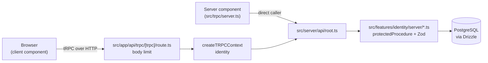

# Architecture

This is a Next.js App Router application with a typed tRPC API over PostgreSQL. Code is grouped by feature: each feature owns its components, router and schemas, and shared infrastructure sits beside the features. The browser calls tRPC procedures; procedures validate input with Zod and query the database through Drizzle with an owner predicate on every row.

## Request flow

## Code map

Reuse these before you write new code.

| Path                                           | Responsibility                                        | Reuse, don't recreate                                                                                                                                               |
| ---------------------------------------------- | ----------------------------------------------------- | ------------------------------------------------------------------------------------------------------------------------------------------------------------------- |
| `src/app/`                                     | Routes, layouts, error boundary. Thin: no data access | Fetch through `~/trpc/server` or `~/trpc/react`                                                                                                                     |
| `src/app/api/trpc/[trpc]/route.ts`             | HTTP entry for tRPC                                   | Body size limit lives here via `limitBody`                                                                                                                          |
| `src/features/<name>/components/`              | UI for one feature                                    | Compose primitives from `~/shared/components/ui`                                                                                                                    |
| `src/features/<name>/server/router.ts`         | The feature's tRPC router                             | Use `protectedProcedure`; filter by `ctx.userId` or `ctx.orgIds`                                                                                                    |
| `src/features/<name>/schemas/`                 | Zod input schemas                                     | Share one schema between router and form                                                                                                                            |
| `src/features/<name>/index.ts`                 | Public exports                                        | Other code imports `~/features/<name>`, never a deep path; barrels also re-export the server APIs shared cross-feature (no client component imports a server value) |
| `src/server/api/trpc.ts`                       | tRPC context, identity, procedures                    | `protectedProcedure` for authenticated work; session plus org membership in `ctx`                                                                                   |
| `src/server/api/root.ts`                       | Aggregates feature routers                            | Add one line per feature                                                                                                                                            |
| `src/server/api/body-limit.ts`                 | Request body size limit                               | `limitBody`                                                                                                                                                         |
| `src/server/db/`                               | Drizzle client and schema                             | Define tables in `schema.ts`; import `db` only from `src/server` and each feature's server folder                                                                   |
| `src/server/auth/`                             | Better Auth instance, email OTP, org, admin           | Import `auth`; never build a second instance                                                                                                                        |
| `src/server/vault/`                            | Envelope-encrypted PII vault (spec 0002)              | `storeSecret`, `redact`, `redactMany`, `redactJson`, `resolveTokens`, `deleteHolderSecrets` only                                                                    |
| `src/server/model/`                            | Model adapter: tiers, budgets, fake (spec 0004)       | `complete`, `completeJson`, `stream`; the tier rule and budget live here                                                                                            |
| `src/features/cases/server/engine.ts`          | Case lifecycle transitions (spec 0004)                | `transition`, the sole writer of `cases.status`                                                                                                                     |
| `src/features/cases/server/planner.ts`         | Deterministic channel choice (spec 0004)              | `planChannel`, `replanAfterFailure`                                                                                                                                 |
| `src/features/cases/server/tools/`             | Tool registry for chat, MCP and executor (0004)       | `callTool`, `listTools`; handlers stay beside the registry                                                                                                          |
| `src/features/cases/server/tools/dispatch.ts`  | Shared chat/MCP dispatcher: 8 checks (0006)           | `dispatchToolCall` with `transport: "mcp"` or `"chat"`; never call `callTool` from a transport                                                                      |
| `src/features/chat/server/mcp.ts`              | MCP server: OAuth gate, tools, resource (0006)        | `mcpServer` (built once per process); `setMcpAuthStub` for tests only                                                                                               |
| `src/features/chat/server/agent.ts`            | In-app chat agent loop, 12 tool rounds (0006)         | `runAgentLoop` streams SSE frames over the dispatcher                                                                                                               |
| `src/features/chat/server/router.ts`           | `chat` tRPC router: status, attach (0006)             | Header reads `status`; uploads go through `attachDocument`                                                                                                          |
| `src/features/identity/server/agents.ts`       | OAuth grants: list, revoke, consent client (0006)     | `agents` router; revoke deletes consent plus token rows                                                                                                             |
| `src/app/api/mcp/[[...path]]/route.ts`         | MCP Streamable-HTTP endpoint (0006)                   | `createNextHandler` plus the subscriptions decline                                                                                                                  |
| `src/app/api/chat/route.ts`                    | In-app chat agent stream (0006)                       | Session plus `chatRequestSchema`, then `runAgentLoop`                                                                                                               |
| `src/features/cases/server/executor.ts`        | Step runner: approvals, sends, re-plan (0005)         | `runNextStep`, `handleStepFailure`; expands `execute-channel` into channel steps                                                                                    |
| `src/features/cases/server/router.ts`          | `cases` tRPC router (0005)                            | `pasteReply`; procedures filter by owner or org                                                                                                                     |
| `src/server/telephony/`                        | Phone backends: simulated fixtures, Twilio (0005)     | `getTelephonyAdapter`; sandbox cases always get `simulated`                                                                                                         |
| `src/server/voice-worker/`                     | Bun media-stream worker for live calls (0005)         | `bun run voice-worker`; turn logic shared with `runCall` via the cases barrel                                                                                       |
| `src/server/audit.ts`                          | Append-only audit chain and verifier                  | `writeAudit`, `verifyAuditChain`                                                                                                                                    |
| `src/server/logger.ts`                         | Redacting server logger                               | `logger`; never `console` with request data                                                                                                                         |
| `src/server/storage.ts`                        | S3 document storage                                   | `createStorage`                                                                                                                                                     |
| `src/server/retention.ts`                      | Daily retention purge                                 | `runRetention`                                                                                                                                                      |
| `src/features/identity/server/mandate-flow.ts` | Mandate lifecycle with injected `MandateDeps`         | Flow functions do the work; routers and routes stay thin                                                                                                            |
| `src/features/providers/server/router.ts`      | Provider search, detail and admin review              | Public `search`/`get`; admin writes clear the Valkey cache                                                                                                          |
| `src/features/providers/server/stats.ts`       | Anonymous per-channel outcome aggregates              | `recordChannelOutcomes` on case close; takes no case ID                                                                                                             |
| `src/shared/components/ui/`                    | shadcn primitives                                     | Add with `bunx shadcn add`; do not put feature logic here                                                                                                           |
| `src/shared/config/env.js`                     | Validated environment                                 | Import `env`; never read `process.env` elsewhere                                                                                                                    |
| `src/shared/config/security-headers.js`        | Response security headers                             | Edit the array; `next.config.js` applies it                                                                                                                         |
| `src/shared/lib/utils.ts`                      | `cn` class merger                                     | Use for conditional Tailwind classes                                                                                                                                |
| `src/trpc/`                                    | tRPC client, server caller, query client              | `api` from `~/trpc/react` or `~/trpc/server`                                                                                                                        |
| `src/shared/config/tokens.ts`                  | Colour, radius and font tokens (spec 0008)            | Edit here, then `make tokens`; `make contrast` checks every text pair                                                                                               |
| `src/styles/globals.css`                       | Tailwind setup; imports generated tokens              | Do not edit `src/styles/generated/` by hand                                                                                                                         |
| `src/shared/config/site.ts`                    | Site name, URL, legal names and emails                | Import `site`; never type the brand name or URL into copy                                                                                                           |
| `src/shared/components/`                       | Brand mark, headers, footer, empty, error, skeleton   | `BrandMark`, `EmptyState`, `RouteError`, `PageSkeleton` before a new state view                                                                                     |
| `e2e/`                                         | Playwright checks at 375, 768 and 1280 px (ADR 0010)  | Add each new route to `publicRoutes` or `appRoutes` in `responsive.e2e.ts`                                                                                          |
| `.storybook/`                                  | Component stories at Phone, Tablet, Desktop           | `make stories`; check new components at all three viewports                                                                                                         |
| `drizzle/`                                     | Generated SQL migrations                              | Run `make db-generate`; do not edit by hand                                                                                                                         |
| `.ast-grep/rules/`                             | Anti-slop and import boundary rules                   | Add a test in `.ast-grep/tests/` with each rule                                                                                                                     |

## Invariants

- Code reads configuration only through `~/shared/config/env`. [enforced by ast-grep]
- `src/shared/**` does not import `~/features/**`. [enforced by ast-grep]
- A feature imports another feature only through `~/features/<name>`. [enforced by ast-grep]
- Files marked `"use client"` do not import `~/server/**` or `server-only` modules. [enforced by ast-grep]
- `src/app/**` does not import `~/server/db`. [enforced by ast-grep]
- Every row a procedure reads or writes is filtered by `ctx.userId` or a `ctx.orgIds` membership; a missing row returns `NOT_FOUND`. [review-only]
- A request with no trusted identity gets `UNAUTHORIZED`. [enforced by vitest]
- Responses carry the security headers in `src/shared/config/security-headers.js`. [enforced by vitest]
- Request bodies over 1 MB get HTTP 413. [enforced by vitest]
- Every directory is listed in `scripts/repo-policy.json`. [enforced by `make policy`]
- Every direct dependency has a row in `docs/dependencies.md`. [enforced by `make policy`]
- No unused files, exports or dependencies. [enforced by knip]
- No duplicated code blocks. [enforced by fallow]
- UI code uses token classes, not raw hex or Tailwind palette colours, and brand controls, not raw `<button>`, `<input>` or `<select>`. [enforced by ast-grep]
- Pages use `min-h-dvh`, never `h-screen`. [enforced by ast-grep]
- Every route has no horizontal scroll, no axe violations and 44 px touch targets at 375, 768 and 1280 px, light and dark. [enforced by `make e2e`]
- Text contrast meets WCAG AA for every token pair. [enforced by `make contrast`]

## Cross-cutting concerns

- **Config.** `src/shared/config/env.js` validates the environment with Zod at build and start. Set `SKIP_ENV_VALIDATION=1` to skip it, for example in Docker builds or when `knip` loads the configuration.
- **Errors.** Procedures throw `TRPCError` with a code. In production the error formatter replaces `INTERNAL_SERVER_ERROR` messages with a generic one, so internals do not leak.
- **Auth.** Better Auth email-OTP sessions. `createTRPCContext` reads the session and the caller's org membership; `protectedProcedure` rejects callers without one. `ctx` carries `userId`, `orgIds` and the `ownerId` alias.
- **Database.** Drizzle over the `postgres` driver, with a 10 second connect timeout. One client per process, cached on `globalThis` outside production.
- **Migrations.** `make db-generate` writes SQL to `drizzle/`; `make db-migrate` applies it. `make db-push` syncs the schema without a migration file and is for local work only.
- **Logging.** tRPC errors print redacted to the server console via `~/server/logger`. Request bodies and query strings are never logged.
